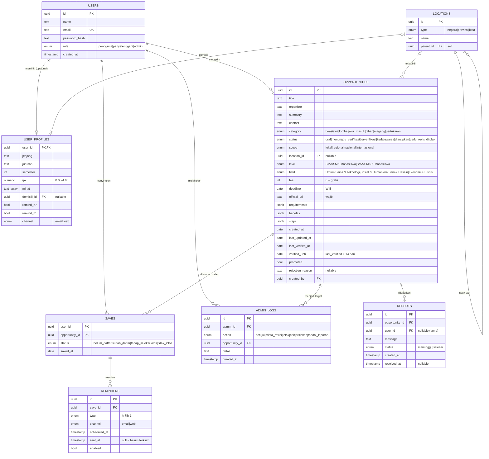
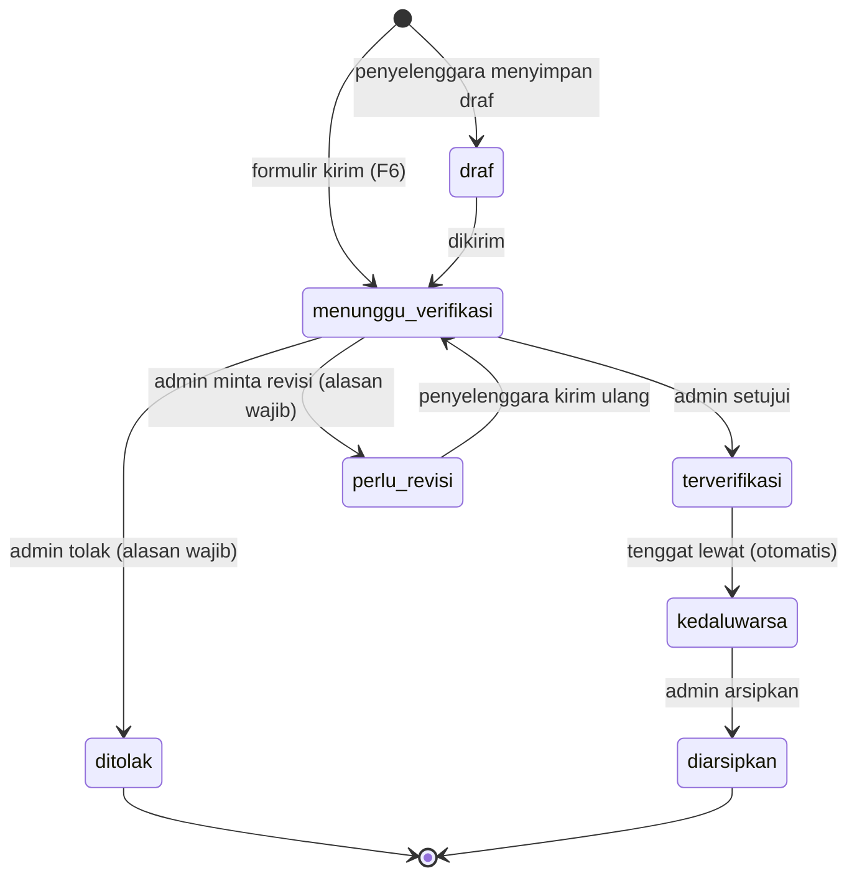

# Model Data BinaEdu

> Dokumen pendamping `docs/style.md` — sumber kebenaran struktur data produk.
> Fase 1 (frontend) memakai **tipe TypeScript** (`lib/schema.ts`) + **repository
> in-memory** (`lib/repository.ts`) dengan seed mock (`lib/data.ts`). Struktur ini
> dirancang agar pemetaan ke PostgreSQL/Supabase pada fase backend berikutnya
> tidak mengubah bentuk data maupun UI.

## 1. Ringkasan Entitas

| Entitas | Peran | File tipe |
|---|---|---|
| `users` | Akun: pengguna, penyelenggara, admin (PRD F6) | `lib/schema.ts` |
| `user_profiles` | Profil opsional F3 (jenjang, IPK, minat, pengaturan pengingat) | `lib/schema.ts` |
| `locations` | Hierarki lokasi: negara → provinsi → kota (PRD §7) | `lib/schema.ts` |
| `opportunities` | Entitas inti: beasiswa/lomba/jalur masuk/hibah/magang/pertukaran | `lib/schema.ts` |
| `saves` | Peluang tersimpan + status pendaftaran (PRD F5) | `lib/schema.ts` |
| `reminders` | Pengingat tenggat H-7/H-1 via email/web (PRD F2) | `lib/schema.ts` |
| `reports` | Laporan "Lapor data salah" — antrean prioritas admin (PRD §6.3 no. 5) | `lib/schema.ts` |
| `admin_logs` | Catatan aktivitas admin (PRD §8 Keamanan) | `lib/schema.ts` |

## 2. Diagram ERD



## 3. Siklus Status Peluang (PRD §6.2)



Aturan yang terikat data:

1. **Tayang di dashboard** = `status = 'terverifikasi'` **dan** `deadline >= hari ini`
   (PRD §6.3 no. 1). Helper: `isTayang()`; pasangannya `isBerakhir()` untuk
   filter "Telah berakhir".
2. **Kiriman penyelenggara** = baris `opportunities` baru berstatus
   `menunggu_verifikasi` dengan `created_by` penyelenggara. Helper: `isKiriman()`.
3. **Verifikasi berkala** = `verified_until = last_verified_at + 14 hari`
   (§6.3 no. 4). Jika `verified_until < hari ini` → badge "Perlu dicek ulang"
   untuk admin. Helper: `needsRecheck()`, konstanta `VERIFICATION_INTERVAL_DAYS`.
4. **Laporan data salah** (`reports.status = 'menunggu'`) tampil di tab
   terpisah dan diprioritaskan di antrean admin (§6.3 no. 5).
5. **Perubahan `deadline`/`requirements`** pada peluang yang disimpan → memicu
   pemberitahuan ke `saves.user_id` (§6.3 no. 7; backend fase berikutnya).

## 4. Kamus Nilai Enum

Semua nilai disimpan lowercase snake_case; label tampilan bahasa Indonesia ada
di `*_LABELS` pada `lib/schema.ts` (mis. `jalur_masuk` → "Jalur Masuk").

| Enum | Nilai |
|---|---|
| `user_role` | `pengguna`, `penyelenggara`, `admin` |
| `category` | `beasiswa`, `lomba`, `jalur_masuk`, `hibah`, `magang`, `pertukaran` |
| `opportunity_status` | `draf`, `menunggu_verifikasi`, `terverifikasi`, `kedaluwarsa`, `diarsipkan`, `perlu_revisi`, `ditolak` |
| `scope` | `lokal`, `regional`, `nasional`, `internasional` |
| `track_status` | `belum_daftar`, `sudah_daftar`, `tahap_seleksi`, `lolos`, `tidak_lolos` |
| `reminder_type` / `channel` | `h-7`, `h-1` / `email`, `web` |
| `report_status` | `menunggu`, `selesai` |
| `admin_action` | `setujui`, `minta_revisi`, `tolak`, `edit`, `arsipkan`, `tandai_laporan` |

## 5. Konvensi Tanggal & Zona Waktu

- Fase 1: semua tanggal berformat **ISO `yyyy-mm-dd`** dengan asumsi **WIB**
  (dokumen PRD F2). Fungsi `addDays()` dan `newVerification()` di
  `lib/schema.ts` bekerja pada format ini.
- Waktu berjalan (`new Date()`) **tidak boleh** dievaluasi saat prerender
  Next 16; hanya di event handler atau komponen client dalam `<Suspense>`.
- Fase backend: gunakan `date` untuk tenggat (zona WIB, `Asia/Jakarta`) dan
  `timestamptz` untuk kejadian berjam (`sent_at`, `created_at`).

## 6. Catatan Pemetaan ke PostgreSQL/Supabase

### 6.1 Tipe kolom

| TypeScript | PostgreSQL |
|---|---|
| `string` (id, url) | `uuid` / `text` |
| enum union | `text` + `CHECK (x IN (...))` atau tipe enum Postgres |
| `string[]` (minat, requirements, benefits, steps) | `text[]` atau `jsonb` |
| `number fee` | `integer` (rupiah, tanpa desimal) |
| tanggal ISO | `date` |
| `string \| null` | nullable kolom |

### 6.2 Constraint & index penting

```sql
-- Email unik
ALTER TABLE users ADD CONSTRAINT users_email_key UNIQUE (email);

-- Profil 1:1
ALTER TABLE user_profiles ADD CONSTRAINT user_profiles_user_id_key UNIQUE (user_id);
ALTER TABLE user_profiles ADD CHECK (ipk IS NULL OR (ipk >= 0 AND ipk <= 4));

-- Lokasi hierarkis
ALTER TABLE locations ADD CONSTRAINT locations_parent_fk
  FOREIGN KEY (parent_id) REFERENCES locations(id);

-- Path lokasi untuk FE (view rekursif, security_invoker)
-- PostgREST tidak mendukung embed self-FK (locations→locations),
-- sehingga FE mengambil rantai nama dari view ini, bukan embed bersarang.
CREATE VIEW location_paths WITH (security_invoker = true) AS
WITH RECURSIVE tree AS (
  SELECT id, ARRAY[name]::text[] AS path FROM locations WHERE parent_id IS NULL
  UNION ALL
  SELECT l.id, array_prepend(l.name, t.path)
  FROM locations l JOIN tree t ON l.parent_id = t.id
)
SELECT id, path FROM tree;

-- Simpan: satu baris per pasangan
ALTER TABLE saves ADD CONSTRAINT saves_pk PRIMARY KEY (user_id, opportunity_id);

-- Aturan tayang: index komposit untuk dashboard
CREATE INDEX opportunities_status_deadline_idx ON opportunities (status, deadline);
CREATE INDEX opportunities_category_idx ON opportunities (category);
CREATE INDEX opportunities_location_idx ON opportunities (location_id);
CREATE INDEX saves_user_idx ON saves (user_id);
CREATE INDEX reminders_due_idx ON reminders (enabled, scheduled_at)
  WHERE sent_at IS NULL;
```

### 6.3 Row Level Security (RLS, bila Supabase)

| Tabel | Kebijakan |
|---|---|
| `opportunities` | Baca publik hanya `status = 'terverifikasi'`; penyelenggara baca tulis milik `created_by`; admin semua |
| `user_profiles` | Pemilik baris saja |
| `saves`, `reminders` | Pemilik baris saja |
| `reports` | Tulis publik (tamu tanpa `user_id`), baca admin |
| `admin_logs` | Baca/tulis admin saja (append-only) |

### 6.4 Migrasi dari repository in-memory

`lib/repository.ts` adalah satu-satunya lapisan yang berbicara dengan data.
Saat backend siap, ganti isi fungsi (`listAktif`, `getOpportunityById`, dst.)
dengan panggilan API/Supabase client — **tanpa mengubah komponen UI**.

## 7. Data Mock (Fase 1)

Seed di `lib/data.ts` adalah **data fiktif** untuk pengembangan FE:

- `LOCATIONS`: Indonesia → Jawa Tengah → Semarang (contoh hierarki §7).
- `USERS`: tiga contoh (admin, penyelenggara, pengguna).
- `OPPORTUNITIES`: 15 peluang terverifikasi, termasuk 2 berlabel `promoted`
  dan 1 contoh "Perlu dicek ulang" (`beasiswa-djarum-plus`), serta 1 yang
  telah berakhir untuk filter dashboard.
- `KIRIMAN`: 4 kiriman antrean admin (2 menunggu, 1 perlu revisi, 1 ditolak).
- `REPORTS` & `ADMIN_LOGS`: contoh laporan dan catatan aktivitas.
